# LKPD 1 — Mengenal Komponen, Terminal, dan Rating PLTS Off-Grid

Paket: Minimum (off-grid 12 V) · Waktu: 2 × 45 menit · Berkas: — (Preset di aplikasi)

## A. Tujuan

1. Menyebutkan fungsi tiap komponen PLTS off-grid paket Minimum.
2. Menunjukkan terminal dan polaritas tiap komponen (PV+, PV−, BAT+, BAT−, BEBAN+, BEBAN−, L, N, PE).
3. Membaca rating utama komponen dari inspektur dan membandingkannya antar-komponen.
4. Mengenali arti warna kabel dan bentuk terminal.

## B. Alat dan Bahan

- Laptop atau tablet dengan SimPLTS (berjalan tanpa internet)
- Lembar kerja ini dan alat tulis

## C. Dasar Teori Singkat

PLTS off-grid tidak tersambung ke jaringan PLN. Energi dari modul surya disimpan di baterai melalui solar charge controller (SCC), lalu dipakai beban DC langsung atau beban AC melalui inverter.

Setiap komponen punya rating (batas kerja) dari datasheet. Rangkaian aman bila arus dan tegangan kerja tidak melebihi rating komponen dan kabel.

## D. Keselamatan Kerja

- Di SimPLTS kesalahan rangkaian menimbulkan akibat yang terlihat (trip, rusak), tetapi tidak berbahaya. Biasakan tetap bekerja dengan urutan yang aman seperti pada alat nyata.
- Pada perangkat nyata, jangan menyentuh terminal yang terbuka saat modul surya terkena cahaya.

## E. Langkah Kerja

1. Buka SimPLTS. Kenali enam area layar: (1) pilihan paket, (2) tingkat Pemula/Mahir, (3) baki komponen, (4) meja kerja, (5) alat ukur, (6) bilah simulasi. Pastikan paket Minimum dan tingkat Pemula terpilih.

   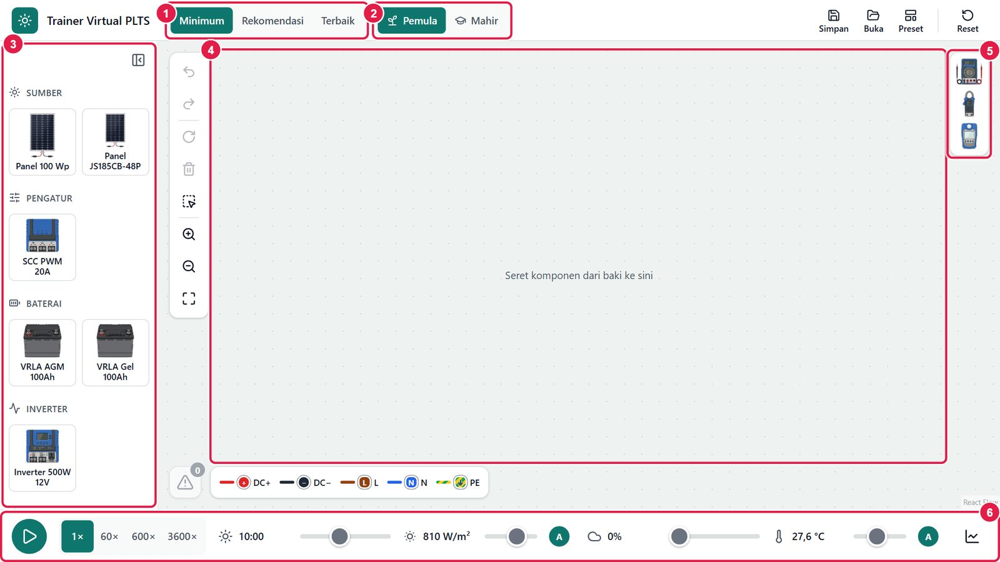

   *Gambar 1.1. Bagian-bagian layar SimPLTS*

2. Ketuk (1) Preset, lalu pilih (2) Minimum. Semua komponen paket tertata di meja, belum dirangkai.

   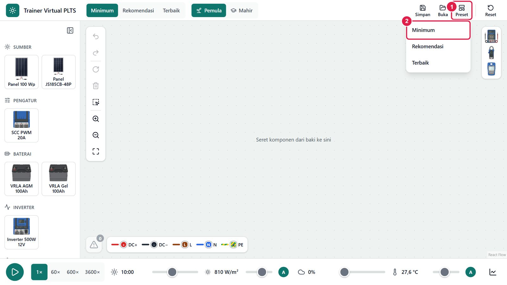

   *Gambar 1.2. Memuat preset Minimum*

3. Amati komponen yang muncul di meja. Tulis nama dan jumlahnya di Tabel 1.

   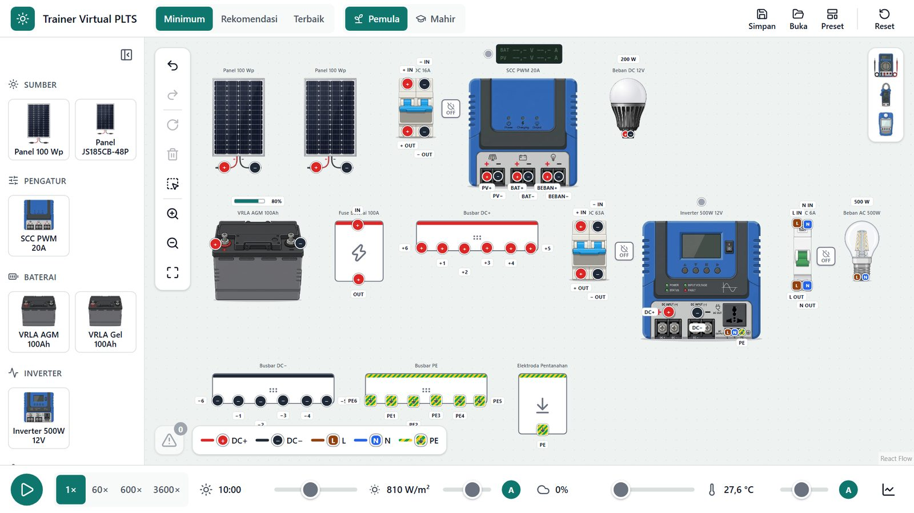

   *Gambar 1.3. Komponen paket Minimum di meja kerja*

4. Ketuk gambar SCC PWM 20A (1). Inspektur muncul di kanan dan menampilkan rating utama (2). Catat ratingnya di Tabel 2.

   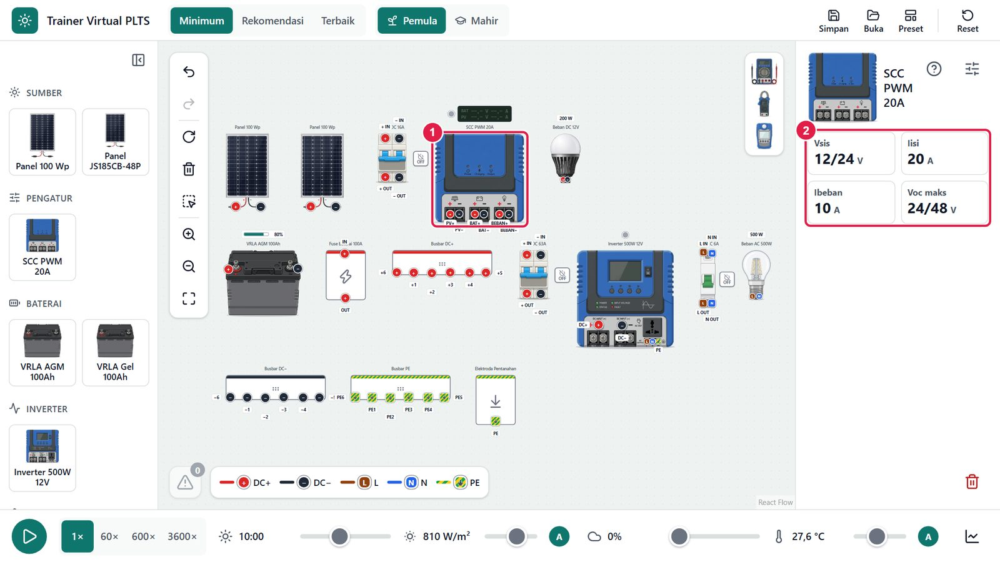

   *Gambar 1.4. Inspektur SCC PWM 20A*

5. Ketuk tombol "?" (1) untuk membaca penjelasan singkat fungsi komponen. Lakukan juga pada komponen lain bila perlu.

   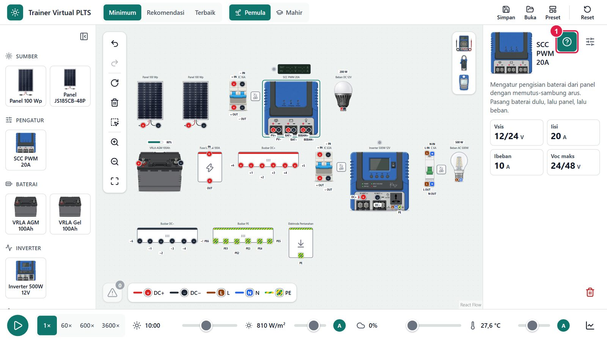

   *Gambar 1.5. Penjelasan singkat komponen*

6. Perhatikan terminal SCC dan baterai. Tanda bulat merah (+) dan hitam (−) menunjukkan polaritas; labelnya tertulis di samping terminal. Lengkapi Tabel 3.

   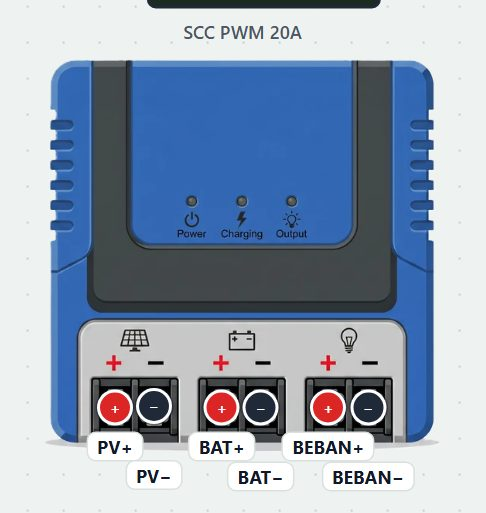
   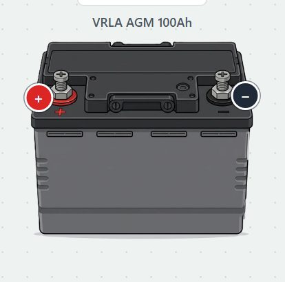

   *Gambar 1.6. Terminal SCC (kiri) dan baterai (kanan)*

7. Ulangi langkah 4 untuk baterai, inverter, panel surya, dan MCB. Catat rating utamanya di Tabel 2.

   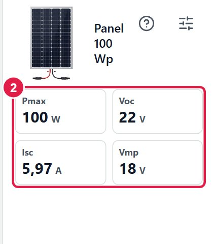
   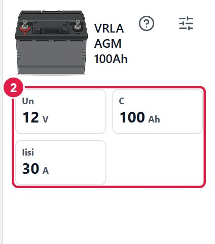
   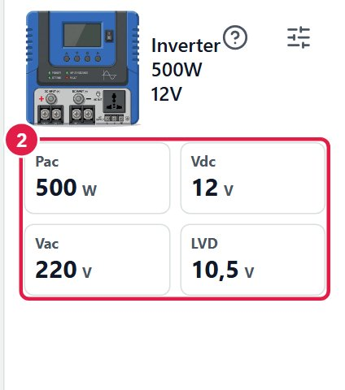

   *Gambar 1.7. Rating utama di inspektur: panel 100 Wp, baterai VRLA AGM 100Ah, inverter 500W 12V*

8. Pilih MCB. Perhatikan bahwa jenis (DC/AC) dan arus pengenal bisa diganti dari inspektur. Jangan ubah dulu; cukup catat arus pengenal bawaannya.

   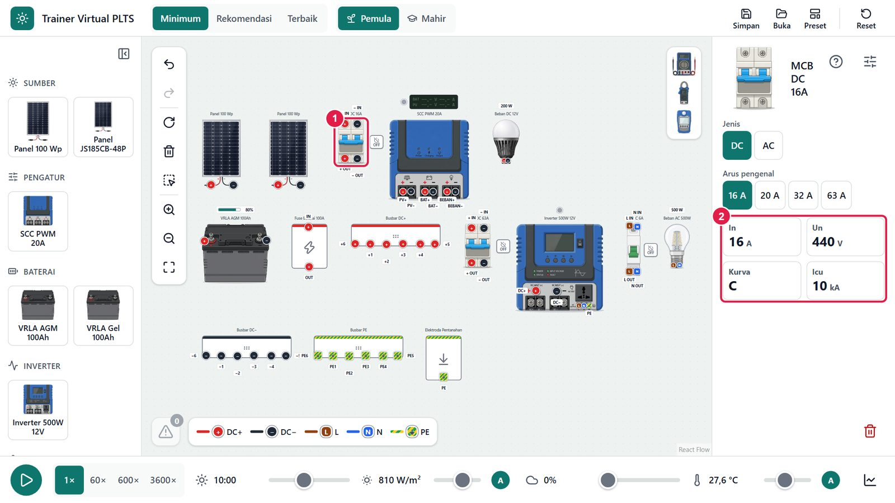

   *Gambar 1.8. Inspektur MCB: jenis, arus pengenal, dan rating*

9. Ketuk area kosong di meja agar inspektur tertutup. Amati (1) legenda warna kabel dan (2) tombol segitiga temuan pemeriksaan di pojok kiri bawah meja.

   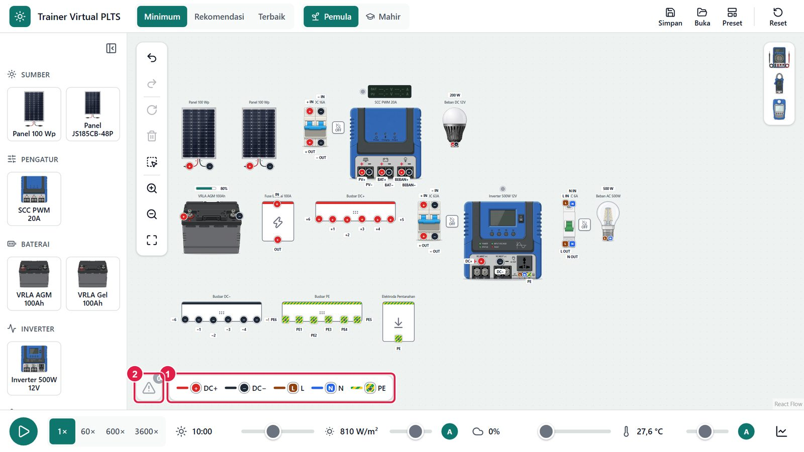

   *Gambar 1.9. Legenda warna kabel dan tombol temuan*

## F. Data Pengamatan

**Tabel 1. Komponen paket Minimum**

| No | Nama komponen | Jumlah | Fungsi singkat |
| --- | --- | --- | --- |
| 1 |   |   |   |
| 2 |   |   |   |
| 3 |   |   |   |
| 4 |   |   |   |
| 5 |   |   |   |
| 6 |   |   |   |
| 7 |   |   |   |
| 8 |   |   |   |

**Tabel 2. Rating utama komponen**

| Komponen | Rating 1 | Rating 2 | Rating 3 | Rating 4 |
| --- | --- | --- | --- | --- |
| SCC PWM 20A |   |   |   |   |
| VRLA AGM 100Ah |   |   |   |   |
| Inverter 500W 12V |   |   |   |   |
| Panel 100 Wp |   |   |   |   |
| MCB DC 16A |   |   |   |   |

**Tabel 3. Terminal dan polaritas**

| Komponen | Nama terminal | Warna tanda | Disambung ke |
| --- | --- | --- | --- |
| Panel 100 Wp |   |   |   |
|  |   |   |   |
| SCC PWM 20A |   |   |   |
|  |   |   |   |
|  |   |   |   |
| Inverter 500W 12V |   |   |   |
|  |   |   |   |

**Tabel 4. Warna kabel**

| Warna | Penghantar | Contoh terminal |
| --- | --- | --- |
| Merah |   |   |
| Hitam |   |   |
| Cokelat |   |   |
| Biru |   |   |
| Hijau-kuning |   |   |

## G. Pertanyaan Analisis

1. Mengapa modul surya tidak boleh disambung langsung ke beban atau inverter? Gunakan penjelasan tombol "?" pada modul surya.
2. Berapa arus maksimum yang boleh diambil dari terminal BEBAN SCC PWM 20A? Beban DC berapa watt (sistem 12 V) yang masih aman?
3. Batas Voc masukan PV SCC pada sistem 12 V adalah 24 V. Apakah dua panel 100 Wp (Voc 22 V) boleh dirangkai seri ke SCC ini? Jelaskan.
4. Inverter 500 W 12 V memiliki LVD 10,5 V. Apa yang terjadi pada inverter bila tegangan baterai turun di bawah nilai tersebut?

## H. Kesimpulan

…
