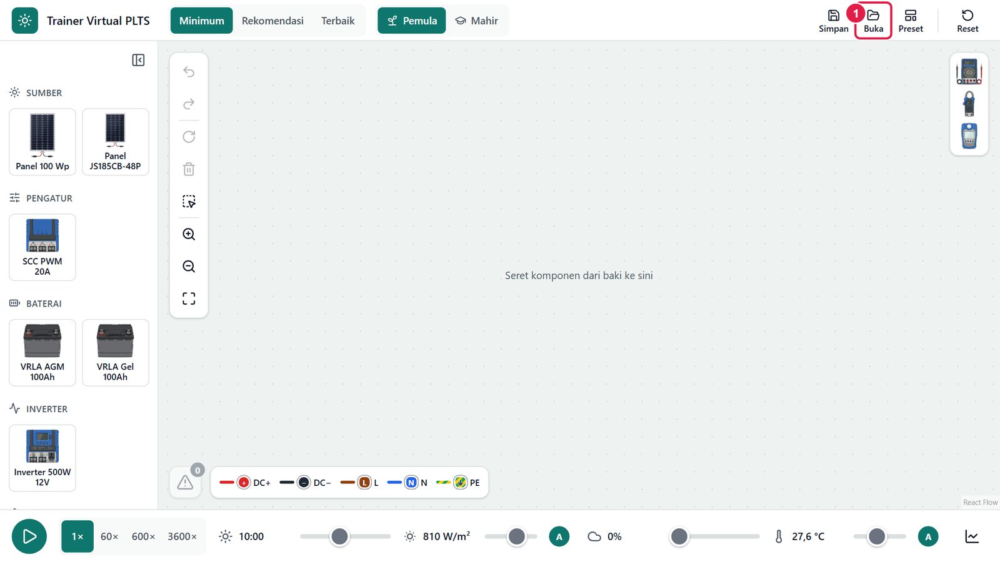
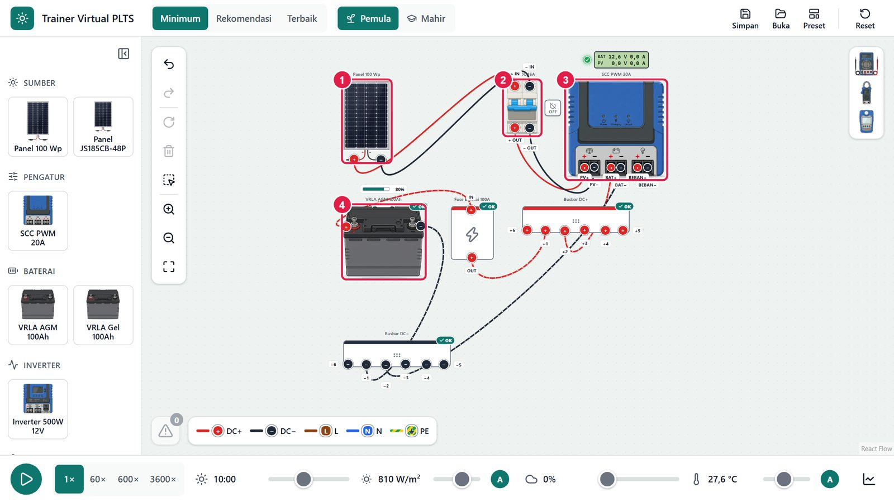
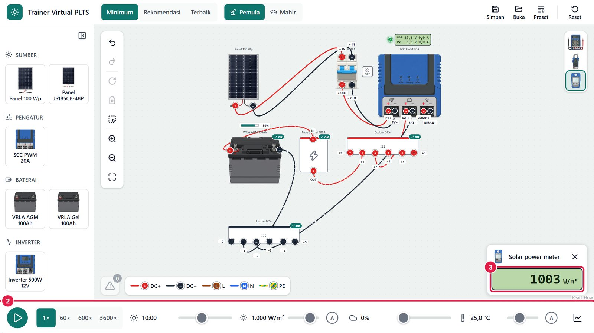
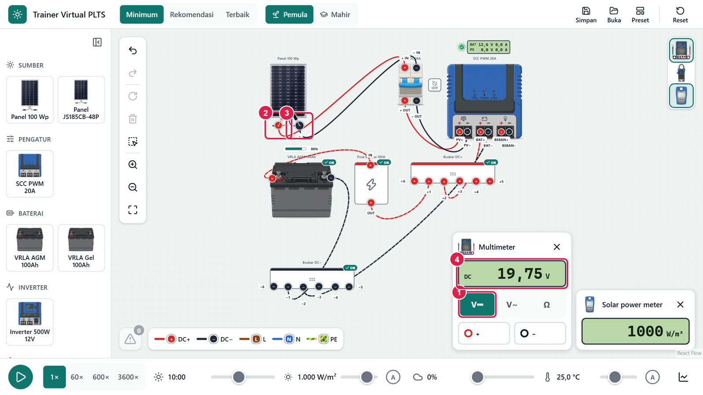
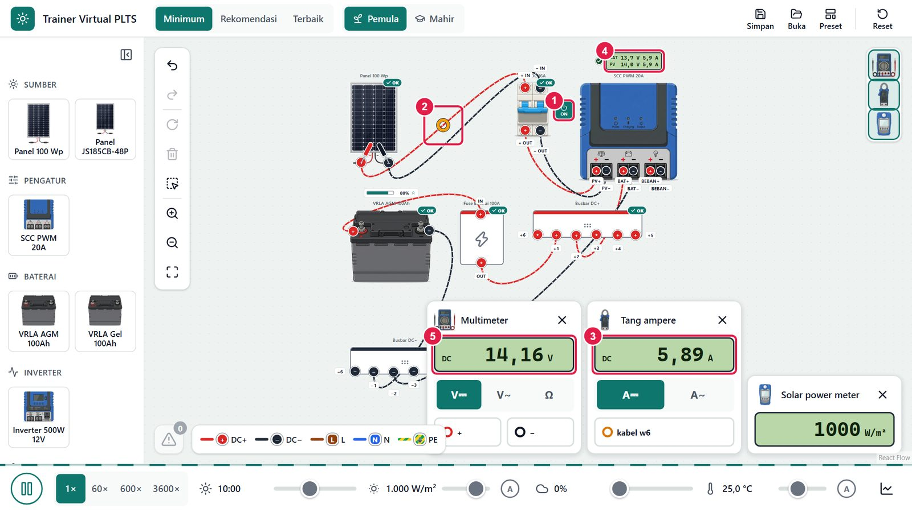

# LKPD 2 — Karakteristik Modul Surya: Pengaruh Iradiasi dan Suhu

Paket: Minimum (off-grid 12 V) · Waktu: 2 × 45 menit · Berkas: lkpd2-modul-surya.simplts.json

## A. Tujuan

1. Mengukur tegangan rangkaian terbuka (Voc) modul surya dengan multimeter.
2. Mengukur arus modul surya dengan tang ampere saat mengisi baterai melalui SCC.
3. Menyimpulkan pengaruh iradiasi dan suhu terhadap tegangan dan arus modul.

## B. Alat dan Bahan

- SimPLTS dan berkas rangkaian lkpd2-modul-surya.simplts.json dari instruktur
- Multimeter, tang ampere, dan solar power meter (di SimPLTS)

## C. Dasar Teori Singkat

Iradiasi (W/m²) adalah daya cahaya matahari per meter persegi. Arus modul hampir sebanding dengan iradiasi, sedangkan tegangannya hanya sedikit berubah.

Suhu sel yang naik menurunkan Voc (koefisien suhu Voc modul 100 Wp: −0,32 %/°C). Suhu sel di lapangan lebih tinggi daripada suhu udara karena modul menyerap panas matahari.

Data datasheet (Voc 22 V, Isc 5,97 A) diukur pada kondisi uji standar (STC): 1000 W/m² dan suhu sel 25 °C.

## D. Keselamatan Kerja

- Ukur Voc saat MCB PV masih OFF (rangkaian terbuka).
- Pada modul nyata, Isc tidak diukur dengan menghubung-singkatkan modul tanpa alat yang sesuai. Di lembar ini arus diukur saat modul bekerja mengisi baterai.

## E. Langkah Kerja

1. Ketuk Buka (1), lalu pilih berkas lkpd2-modul-surya.simplts.json.

   

   *Gambar 2.1. Membuka berkas rangkaian*

2. Amati rangkaian: (1) panel 100 Wp, (2) MCB PV dalam keadaan OFF, (3) SCC, (4) baterai yang sudah tersambung ke SCC lewat fuse dan busbar.

   

   *Gambar 2.2. Rangkaian latihan LKPD 2*

3. Atur iradiasi (1) ke 1000 W/m² dan suhu lingkungan (2) ke 25 °C dengan menggeser slider. Tanda "A" menjadi abu-abu, artinya nilai diatur manual. Buka solar power meter (3) untuk memastikan iradiasinya.

   

   *Gambar 2.3. Mengatur iradiasi dan suhu*

4. Buka multimeter dan pilih (1) V⎓ (tegangan DC). Seret probe merah ke terminal + panel (2) dan probe hitam ke terminal − panel (3). Baca Voc pada layar (4) dan catat di Tabel 1.

   

   *Gambar 2.4. Mengukur Voc panel*

5. Tanpa melepas probe, ubah iradiasi menjadi 800, 600, 400, dan 200 W/m². Tunggu angka stabil (±1 detik), lalu catat Voc di Tabel 1.

6. Kembalikan iradiasi ke 1000 W/m². Ubah suhu lingkungan menjadi 15, 25, 35, dan 45 °C. Catat Voc di Tabel 2.

7. Kembalikan suhu ke 25 °C. Nyalakan MCB PV (1). Buka tang ampere, ketuk jepitan lalu ketuk kabel dari + panel ke MCB (2). Jalankan simulasi (▶). Baca arus (3), LCD SCC (4), dan tegangan panel di multimeter (5).

   

   *Gambar 2.5. Mengukur arus panel saat mengisi baterai*

8. Ubah iradiasi menjadi 800, 600, 400, dan 200 W/m². Catat arus dan tegangan panel di Tabel 3, lalu hitung dayanya (P = V × I).

## F. Data Pengamatan

**Tabel 1. Voc terhadap iradiasi (suhu lingkungan 25 °C, MCB OFF)**

| Iradiasi (W/m²) | Voc terukur (V) | Keterangan |
| --- | --- | --- |
| 1000 |   |   |
| 800 |   |   |
| 600 |   |   |
| 400 |   |   |
| 200 |   |   |

**Tabel 2. Voc terhadap suhu (iradiasi 1000 W/m², MCB OFF)**

| Suhu lingkungan (°C) | Voc terukur (V) | Selisih terhadap 25 °C (V) |
| --- | --- | --- |
| 15 |   |   |
| 25 |   |   |
| 35 |   |   |
| 45 |   |   |

**Tabel 3. Arus dan daya panel saat mengisi baterai (suhu 25 °C, MCB ON)**

| Iradiasi (W/m²) | I panel (A) | V panel (V) | P = V × I (W) |
| --- | --- | --- | --- |
| 1000 |   |   |   |
| 800 |   |   |   |
| 600 |   |   |   |
| 400 |   |   |   |
| 200 |   |   |   |

## G. Grafik

Buat grafik arus panel (sumbu Y) terhadap iradiasi (sumbu X) dari Tabel 3.

## H. Pertanyaan Analisis

1. Bagaimana perubahan arus panel bila iradiasi diturunkan setengahnya? Buktikan dengan data Tabel 3.
2. Mengapa Voc pada 1000 W/m² justru sedikit lebih rendah daripada pada 400 W/m²? (Petunjuk: pikirkan suhu sel.)
3. Voc terukur pada 25 °C lebih kecil daripada Voc datasheet (22 V). Jelaskan penyebabnya.
4. Saat mengisi baterai, tegangan panel hanya sekitar 14 V, bukan 18 V (Vmp). Mengapa? (Petunjuk: SCC PWM menyambungkan panel langsung ke baterai.)
5. Hari mendung menurunkan iradiasi. Besaran mana yang paling terpengaruh: tegangan atau arus?

## I. Kesimpulan

…
