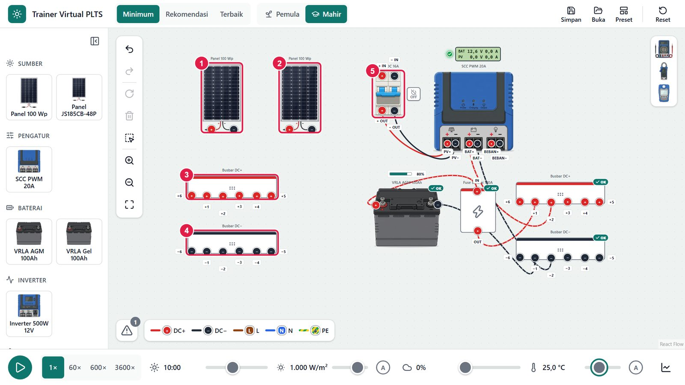
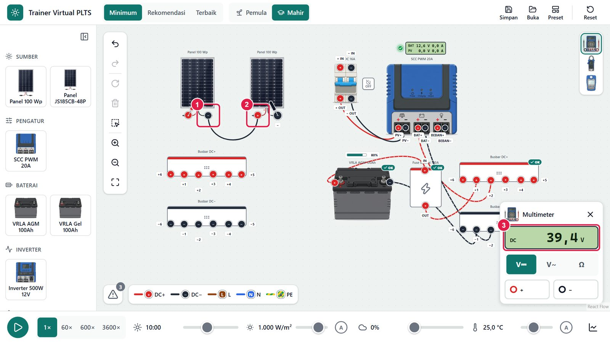
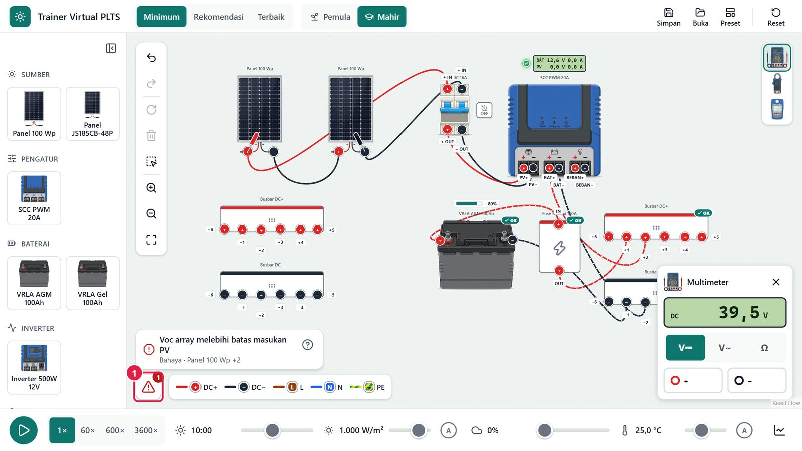
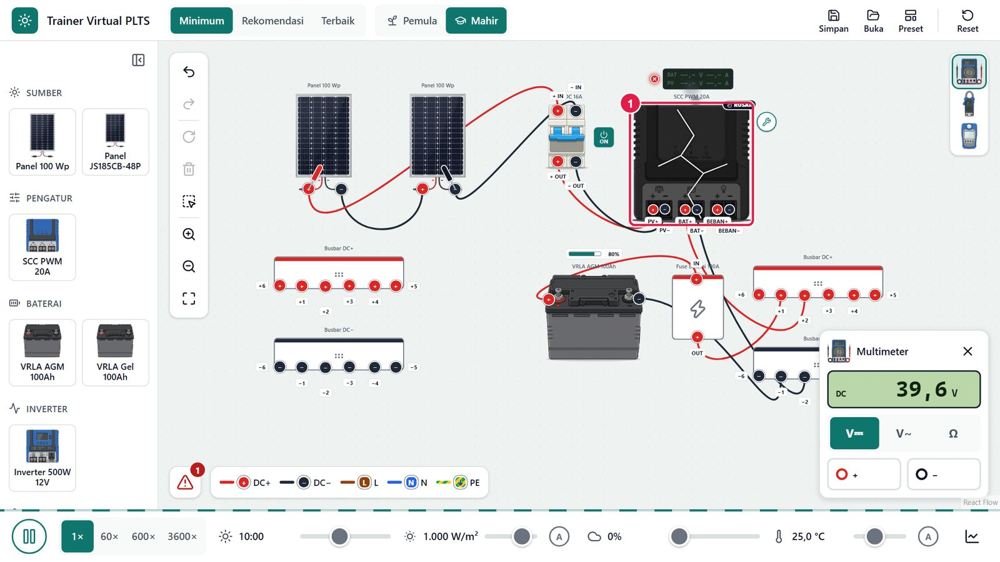
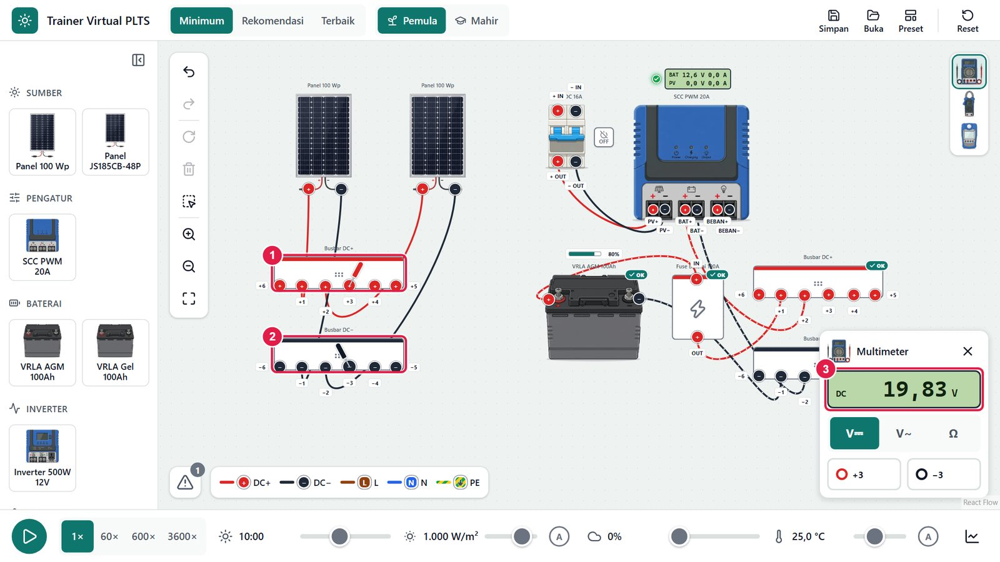
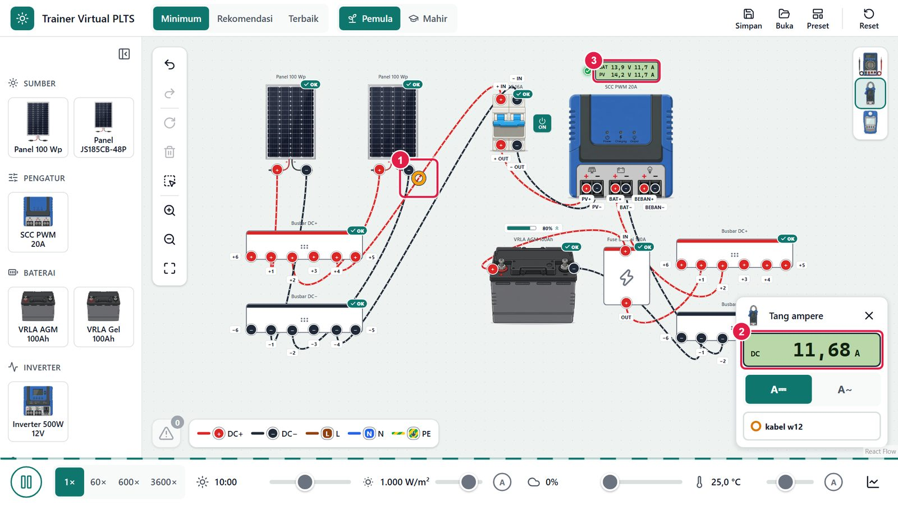

# LKPD 3 — Rangkaian Seri dan Paralel Modul Surya

Paket: Minimum (off-grid 12 V) · Waktu: 2 × 45 menit · Berkas: lkpd3-seri-paralel.simplts.json

## A. Tujuan

1. Merangkai dua modul surya secara seri dan paralel.
2. Mengukur Voc dan arus rangkaian seri dan paralel.
3. Memeriksa kesesuaian Voc array dengan batas masukan PV SCC sebelum energisasi.

## B. Alat dan Bahan

- SimPLTS dan berkas lkpd3-seri-paralel.simplts.json
- Multimeter dan tang ampere (di SimPLTS)

## C. Dasar Teori Singkat

Seri: kutub − modul pertama disambung ke kutub + modul kedua. Tegangan dijumlahkan, arus tetap.

Paralel: semua kutub + disatukan dan semua kutub − disatukan (di sini lewat busbar). Arus dijumlahkan, tegangan tetap.

Voc array harus lebih kecil daripada batas Voc masukan PV SCC. SCC PWM 20A pada sistem 12 V: Voc maks 24 V.

## D. Keselamatan Kerja

- Selalu ukur Voc array sebelum MCB PV dinyalakan.
- Rangkai saat MCB PV OFF. Merangkai saat MCB ON tercatat sebagai temuan "Merangkai saat MCB masih ON".

## E. Langkah Kerja

1. Buka berkas lkpd3-seri-paralel.simplts.json. Pilih tingkat Mahir agar sambungan seri yang berisiko tidak ditolak. Atur iradiasi 1000 W/m² dan suhu 25 °C. Kenali: (1)(2) dua panel, (3) busbar DC+ PV, (4) busbar DC− PV, (5) MCB PV.

   

   *Gambar 3.1. Rangkaian awal LKPD 3*

2. Bagian A, seri. Sambung kabel dari terminal − panel 1 (1) ke terminal + panel 2 (2): ketuk terminal asal, lalu terminal tujuan. Ukur Voc antara + panel 1 dan − panel 2 (3). Catat di Tabel 1.

   

   *Gambar 3.2. Voc dua panel seri*

3. Sambung + panel 1 ke + IN MCB PV dan − panel 2 ke − IN MCB PV. Buka segitiga temuan (1). Catat temuan yang muncul di Tabel 1.

   

   *Gambar 3.3. Temuan pemeriksaan sebelum energisasi*

4. Untuk membuktikan akibatnya, nyalakan MCB PV dan jalankan simulasi. Amati SCC (1). Catat akibatnya.

   

   *Gambar 3.4. Akibat Voc melebihi batas SCC*

5. Ketuk Reset di bilah atas dua kali untuk mereset percobaan, lalu buka ulang berkas lkpd3-seri-paralel.simplts.json (rangkaian kembali seperti awal). Pilih tingkat Pemula.

6. Bagian B, paralel. Sambung + panel 1 dan + panel 2 ke busbar DC+ PV (1), lalu − panel 1 dan − panel 2 ke busbar DC− PV (2). Ukur Voc antara kedua busbar (3). Catat di Tabel 2.

   

   *Gambar 3.5. Voc dua panel paralel*

7. Sambung busbar DC+ PV ke + IN MCB PV dan busbar DC− PV ke − IN MCB PV. Pastikan tidak ada temuan, lalu nyalakan MCB PV dan jalankan simulasi.

8. Jepit kabel + panel 1, lalu kabel + panel 2, lalu kabel dari busbar ke MCB (1) dengan tang ampere. Catat ketiga arus (2) dan bacaan LCD SCC (3) di Tabel 2.

   

   *Gambar 3.6. Arus tiap panel dan arus total*

## F. Data Pengamatan

**Tabel 1. Rangkaian seri (1000 W/m², 25 °C)**

| Besaran | Hasil | Keterangan |
| --- | --- | --- |
| Voc satu panel (dari LKPD 2) |   |   |
| Voc dua panel seri |   |   |
| Temuan pemeriksaan |   |   |
| Akibat pada SCC saat MCB ON |   |   |

**Tabel 2. Rangkaian paralel (1000 W/m², 25 °C)**

| Besaran | Hasil | Keterangan |
| --- | --- | --- |
| Voc paralel (V) |   |   |
| Arus panel 1 (A) |   |   |
| Arus panel 2 (A) |   |   |
| Arus total ke MCB (A) |   |   |
| LCD SCC: V PV dan A PV |   |   |

## G. Pertanyaan Analisis

1. Bandingkan Voc seri dengan Voc satu panel. Apa hubungannya?
2. Bandingkan arus total paralel dengan jumlah arus panel 1 dan panel 2.
3. Mengapa susunan seri tidak cocok untuk SCC PWM 20A pada sistem 12 V, tetapi cocok untuk SCC MPPT bertegangan masukan tinggi?
4. Arus total paralel sekitar 11,7 A. Apakah MCB PV 16 A sudah cukup? Mengapa di lapangan rating proteksi PV dipilih lebih besar dari Isc (misalnya 1,25 × Isc atau lebih)? [PERLU VERIFIKASI faktor sesuai PUIL]
5. Daya PV maksimum SCC PWM 20A pada 12 V adalah 240 W. Berapa modul 100 Wp paling banyak yang boleh dipasang paralel?

## H. Kesimpulan

…
