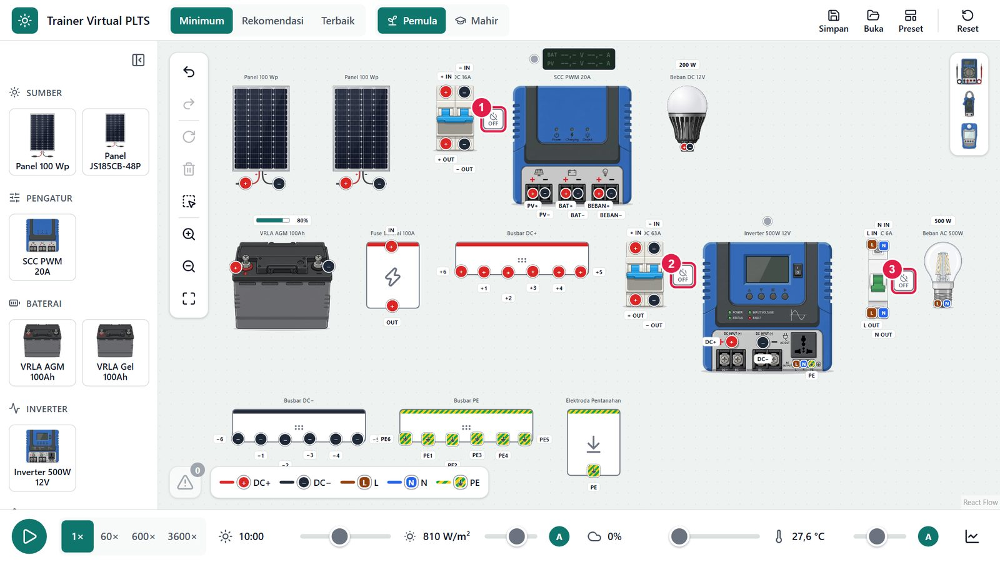
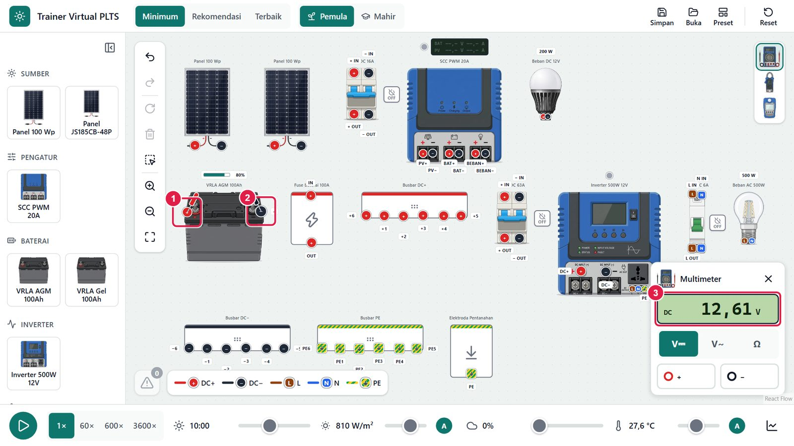
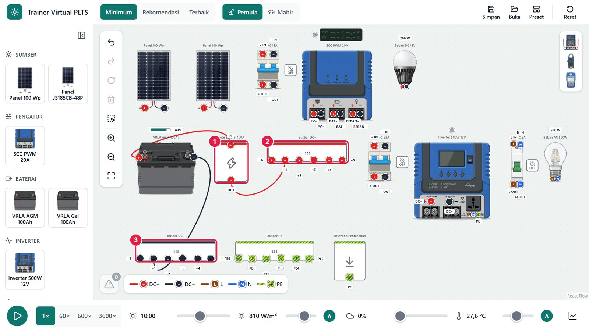
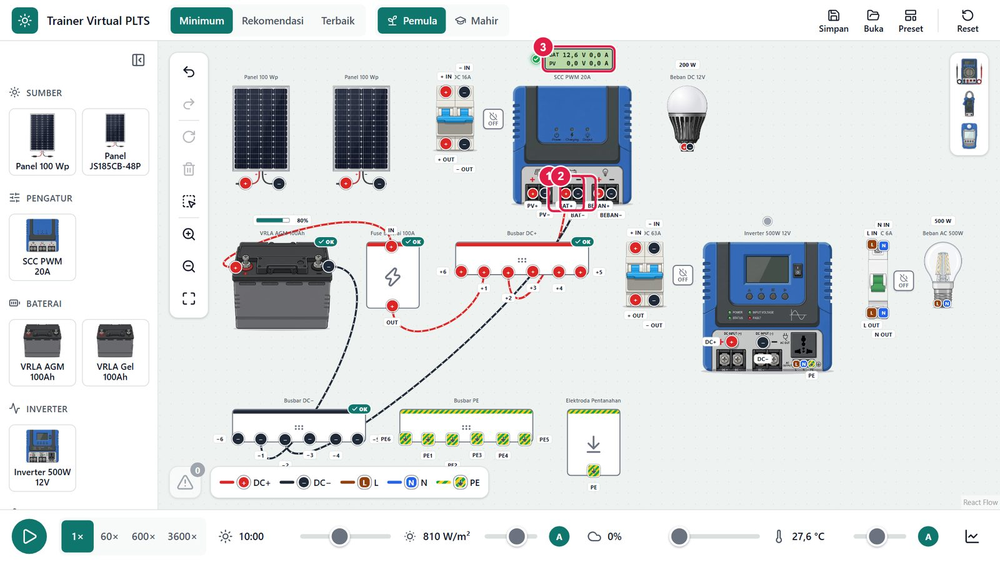
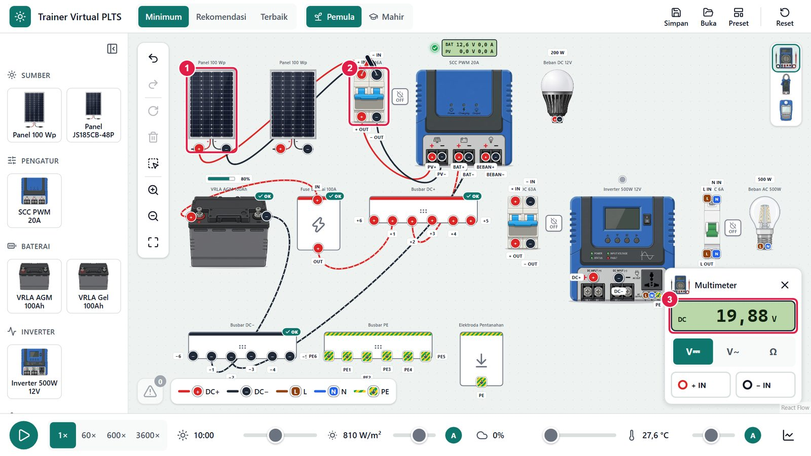
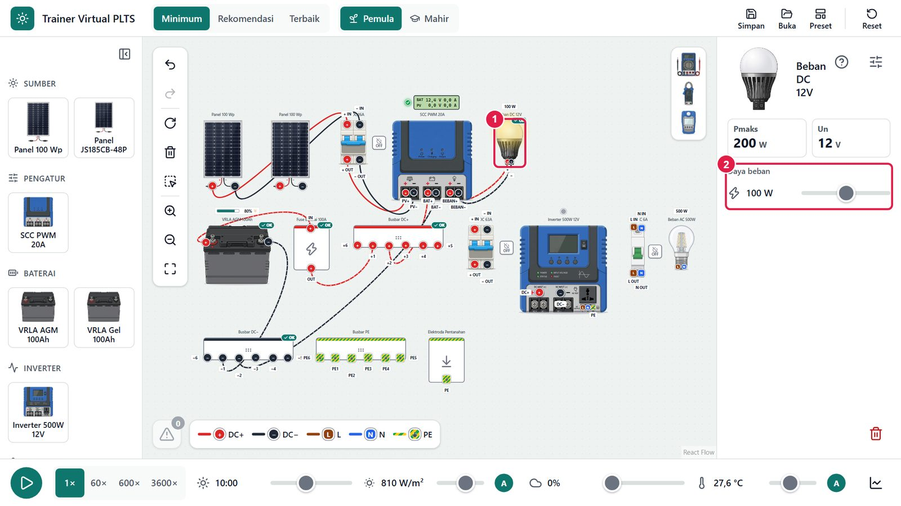
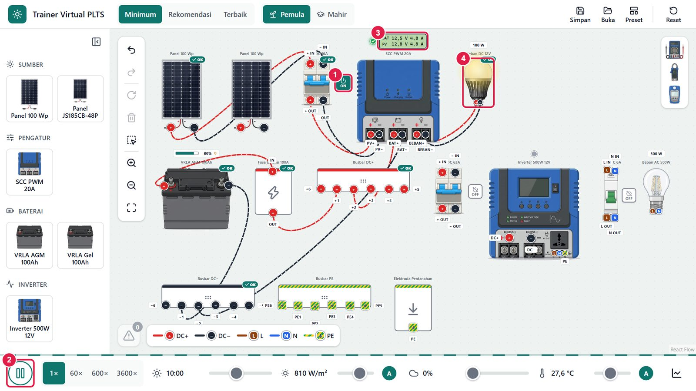
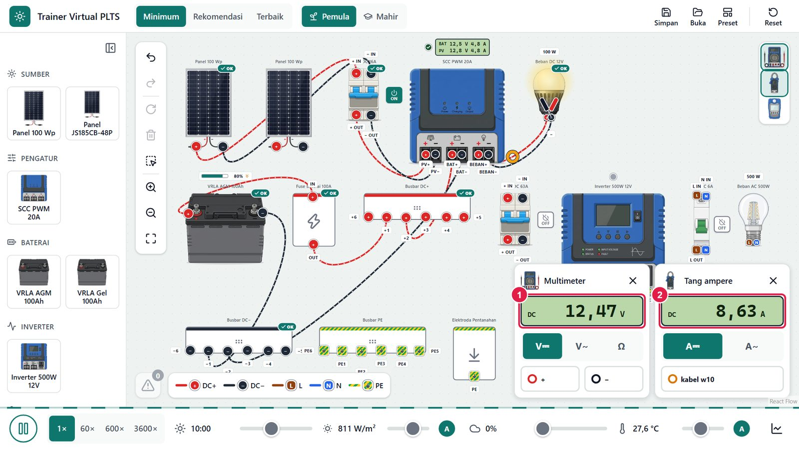
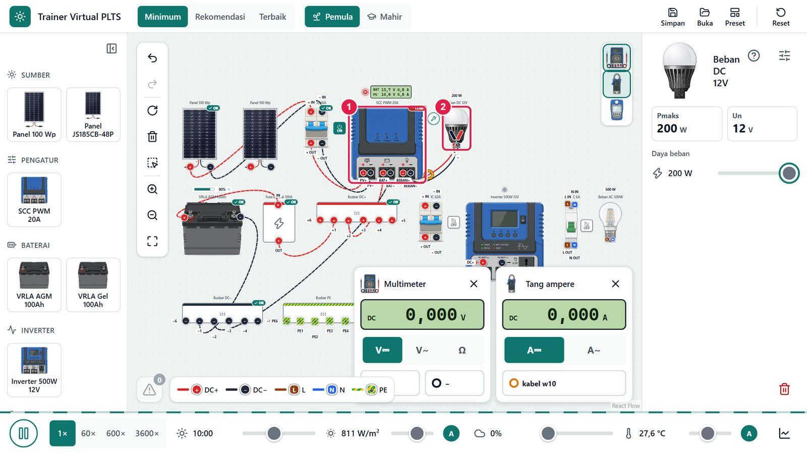

# LKPD 4 — Merangkai PLTS Off-Grid 12 V dengan Beban DC

Paket: Minimum (off-grid 12 V) · Waktu: 3 × 45 menit · Berkas: — (Preset di aplikasi)

## A. Tujuan

1. Merangkai PLTS off-grid 12 V: baterai, SCC, modul surya, dan beban DC.
2. Menerapkan urutan aman: isolasi sumber, ukur sebelum energisasi, baterai dahulu, lalu PV, lalu beban.
3. Mengukur tegangan dan arus beban DC serta mengenali proteksi beban lebih pada SCC.

## B. Alat dan Bahan

- SimPLTS (preset Minimum, tingkat Pemula)
- Multimeter dan tang ampere (di SimPLTS)

## C. Dasar Teori Singkat

SCC mengenali tegangan sistem (12 V atau 24 V) dari baterai, jadi baterai harus disambung lebih dahulu. Urutan lepas adalah kebalikannya: beban, PV, baru baterai.

Fuse baterai melindungi kabel baterai dari arus hubung singkat. MCB PV dipakai sebagai pemisah dan pengaman sisi panel.

Terminal BEBAN SCC PWM 20A dibatasi 10 A. Beban yang lebih besar harus memakai inverter atau disambung langsung ke busbar dengan proteksi sendiri.

## D. Keselamatan Kerja

- Pastikan semua MCB OFF sebelum merangkai (isolasi sumber).
- Periksa polaritas setiap kabel: merah ke +, hitam ke −.
- Ukur tegangan baterai dan Voc panel sebelum MCB dinyalakan.
- Nyalakan MCB satu per satu sambil mengamati indikator.

## E. Langkah Kerja

1. Muat Preset → Minimum (lihat LKPD 1). Isolasi sumber: pastikan semua tuas MCB (1)(2)(3) bertanda OFF.

   

   *Gambar 4.1. Isolasi: semua MCB OFF*

2. Buka multimeter (V⎓). Ukur tegangan baterai: probe merah ke + (1), hitam ke − (2). Catat bacaan (3) di Tabel 1. Tutup multimeter.

   

   *Gambar 4.2. Mengukur tegangan baterai*

3. Sambung baterai: + baterai ke IN fuse, OUT fuse ke busbar DC+ (+1), dan − baterai ke busbar DC− (−1). Tanda "OK" muncul pada komponen yang tersambung benar.

   

   *Gambar 4.3. Kabel baterai, fuse, dan busbar*

4. Sambung busbar DC+ (+2) ke BAT+ SCC (1) dan busbar DC− (−2) ke BAT− SCC (2). LCD SCC (3) menyala dan menampilkan tegangan baterai.

   

   *Gambar 4.4. SCC mendapat tegangan baterai*

5. Sambung + panel 1 ke + IN MCB PV dan − panel 1 ke − IN MCB PV; lalu + OUT MCB ke PV+ SCC dan − OUT MCB ke PV− SCC. Sebelum MCB dinyalakan, ukur Voc di sisi IN MCB (3). Catat di Tabel 1.

   

   *Gambar 4.5. Kabel PV dan pengukuran Voc sebelum energisasi*

6. Sambung BEBAN+ SCC ke terminal + beban DC dan BEBAN− ke terminal −. Ketuk beban DC (1), lalu geser slider daya (2) ke 100 W.

   

   *Gambar 4.6. Mengatur daya beban DC*

7. Pastikan segitiga temuan bernilai 0. Energisasi: nyalakan MCB PV (1), lalu jalankan simulasi (2). Amati LCD SCC (3) dan lampu beban (4). Catat di Tabel 2.

   

   *Gambar 4.7. Energisasi bertahap*

8. Ukur tegangan beban dengan multimeter dan arus beban dengan tang ampere pada kabel BEBAN+. Catat (1)(2) di Tabel 2 dan hitung dayanya.

   

   *Gambar 4.8. Mengukur tegangan dan arus beban DC*

9. Ketuk beban DC, naikkan daya ke 200 W, lalu tunggu beberapa detik. Amati tanda pada SCC (1) dan beban (2). Catat di Tabel 2. Kembalikan daya ke 100 W, lalu ketuk tombol kunci pas pada SCC untuk mereset beban lebih.

   

   *Gambar 4.9. Beban lebih pada terminal BEBAN SCC*

10. Simpan rangkaian dengan tombol Simpan (berkas .simplts.json). Berkas ini dipakai lagi di LKPD 5.

## F. Data Pengamatan

**Tabel 1. Pemeriksaan sebelum energisasi**

| Pemeriksaan | Hasil | Sesuai? (✓/✗) |
| --- | --- | --- |
| Semua MCB OFF |   |   |
| Tegangan baterai (V) |   |   |
| Polaritas kabel baterai ke SCC |   |   |
| Voc di sisi IN MCB PV (V) |   |   |
| Voc < batas SCC 24 V? |   |   |
| Jumlah temuan pemeriksaan |   |   |

**Tabel 2. Pengamatan setelah energisasi**

| Besaran | Beban 100 W | Beban 200 W |
| --- | --- | --- |
| LCD SCC: BAT (V / A) |   |   |
| LCD SCC: PV (V / A) |   |   |
| Tegangan beban (V) |   |   |
| Arus beban (A) |   |   |
| Daya beban = V × I (W) |   |   |
| Tanda pada SCC / beban |   |   |

## G. Pertanyaan Analisis

1. Mengapa baterai harus disambung ke SCC sebelum panel surya?
2. Mengapa Voc diukur di sisi IN MCB sebelum MCB dinyalakan?
3. Pada beban 200 W, berapa arus yang diminta beban? Bandingkan dengan rating Ibeban SCC. Apa yang dilakukan SCC?
4. Tuliskan urutan melepas rangkaian ini dengan aman.
5. Bila ingin memakai beban DC 200 W, bagaimana cara menyambungnya agar SCC tidak beban lebih?

## H. Kesimpulan

…
