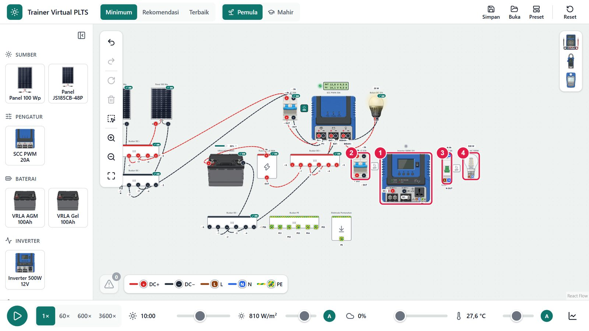
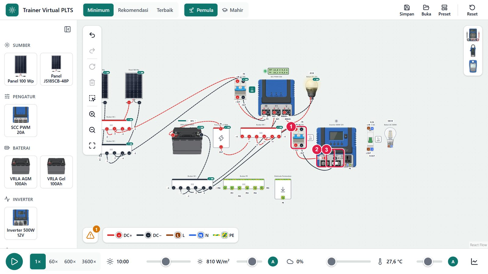
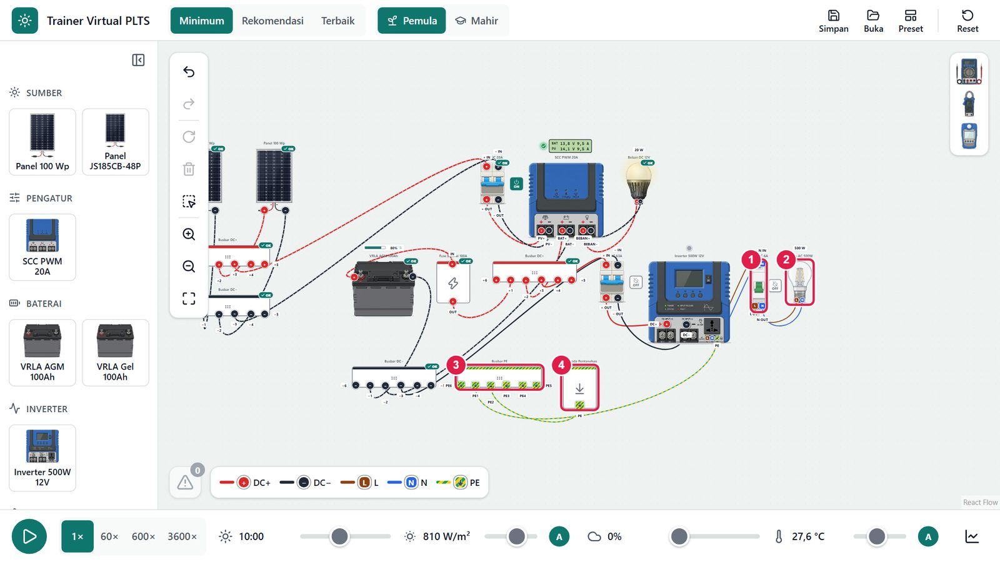
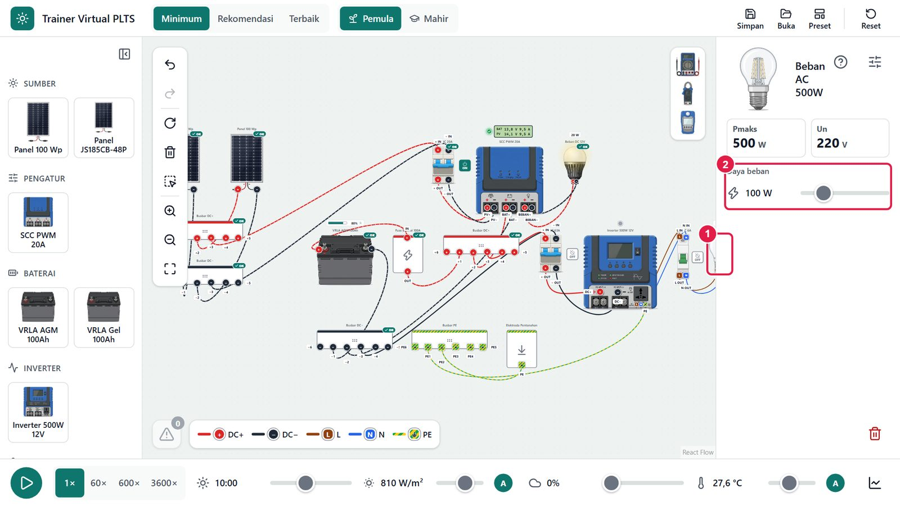
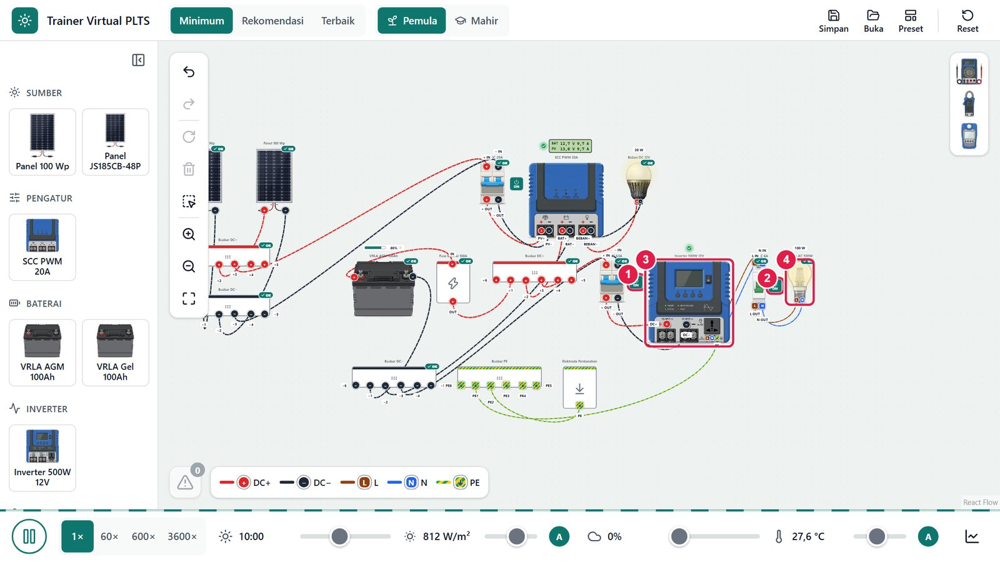
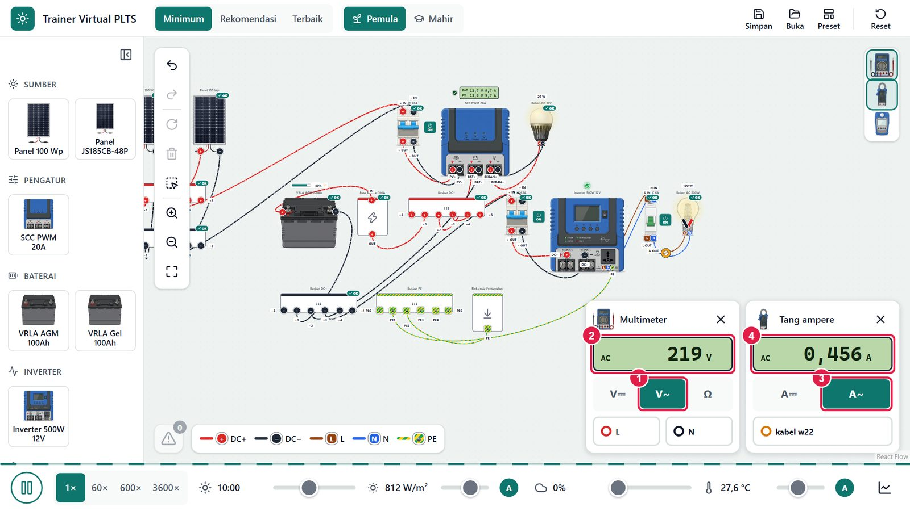
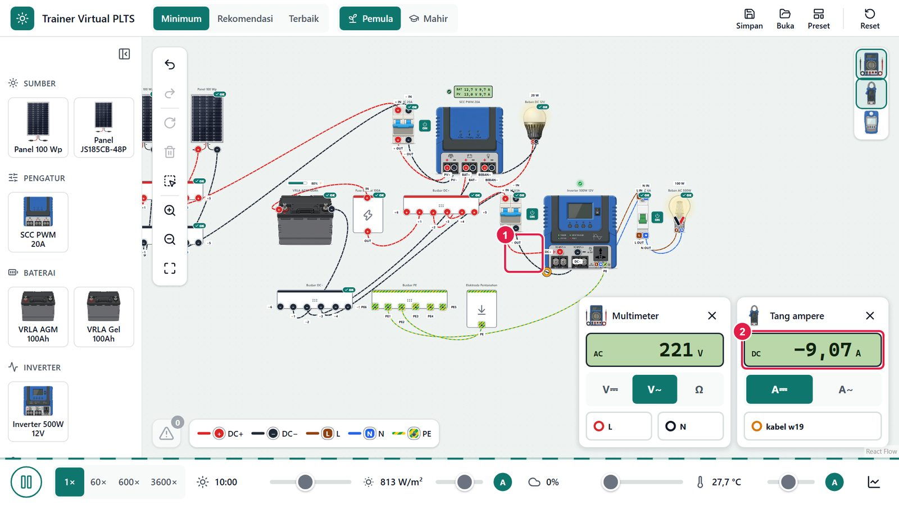
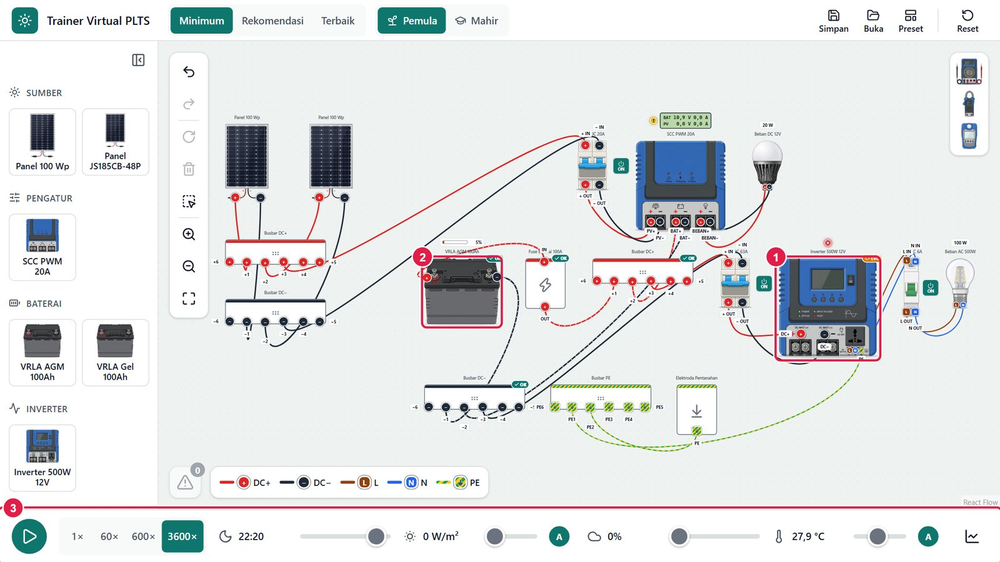
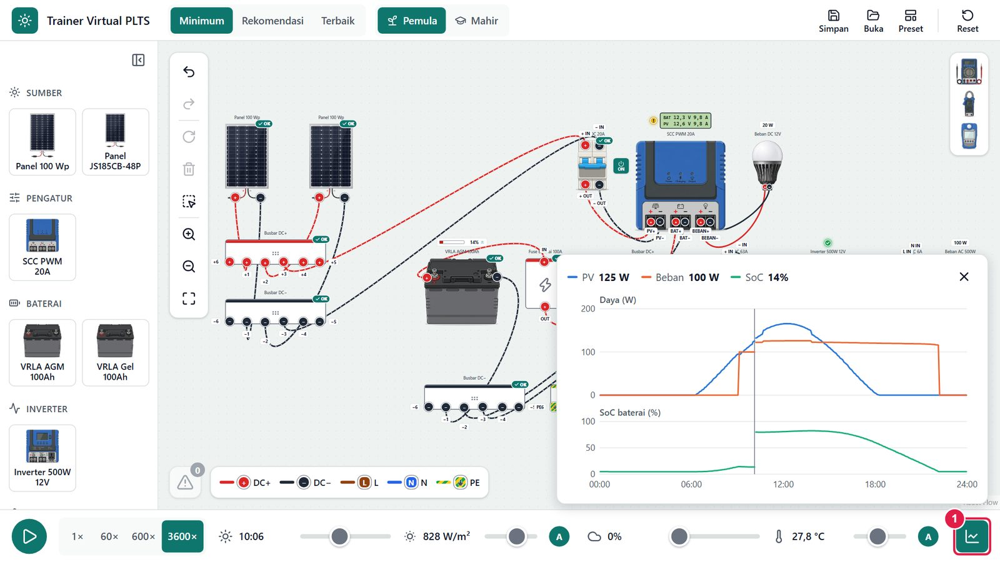

# LKPD 5 — Inverter, Beban AC, dan Neraca Energi Harian

Paket: Minimum (off-grid 12 V) · Waktu: 3 × 45 menit · Berkas: lkpd5-sistem-dc.simplts.json

## A. Tujuan

1. Merangkai inverter, MCB AC, beban AC, dan pembumian PE pada sistem off-grid.
2. Mengukur tegangan dan arus AC keluaran inverter serta arus DC masukannya.
3. Mengamati SoC baterai, pemutusan LVD inverter, dan grafik energi 24 jam.

## B. Alat dan Bahan

- SimPLTS dan berkas lkpd5-sistem-dc.simplts.json (atau berkas hasil LKPD 4)
- Multimeter dan tang ampere (di SimPLTS)

## C. Dasar Teori Singkat

Inverter mengubah DC 12 V dari baterai menjadi AC 220 V. Arus DC masukan ≈ daya AC ÷ (efisiensi × tegangan baterai) ditambah konsumsi tanpa beban, sehingga jauh lebih besar daripada arus AC.

SoC (state of charge) adalah persentase isi baterai. Inverter memutus beban bila tegangan baterai turun di bawah ambang LVD (10,5 V) dan menyala lagi setelah tegangan naik di atas 12,5 V.

Badan inverter harus dibumikan: terminal PE ke busbar PE, lalu ke elektroda pentanahan.

## D. Keselamatan Kerja

- Rangkai saat MCB inverter dan MCB AC OFF.
- Ukur tegangan AC hanya dengan fungsi V~ dan probe pada L dan N.
- Kabel DC inverter membawa arus besar; gunakan penampang yang cukup (berkas memakai 10 mm²).

## E. Langkah Kerja

1. Buka berkas lkpd5-sistem-dc.simplts.json. Sistem DC (dua panel paralel, SCC, baterai, beban DC 20 W) sudah terangkai. Nyalakan MCB PV. Kenali komponen yang akan dirangkai: (1) inverter, (2) MCB DC 63A, (3) MCB AC 6A, (4) beban AC.

   

   *Gambar 5.1. Sistem DC siap ditambah inverter*

2. Sambung busbar DC+ (+3) ke + IN MCB DC 63A dan busbar DC− (−3) ke − IN. Sambung + OUT MCB ke DC+ inverter (2) dan − OUT ke DC− inverter (3).

   

   *Gambar 5.2. Kabel DC ke inverter*

3. Sambung L inverter ke L IN MCB AC, N inverter ke N IN; L OUT dan N OUT MCB AC ke L dan N beban AC. Sambung PE inverter ke busbar PE dan busbar PE ke elektroda. Periksa segitiga temuan = 0.

   

   *Gambar 5.3. Kabel AC dan pembumian*

4. Ketuk beban AC (1) dan atur daya (2) ke 100 W.

   

   *Gambar 5.4. Mengatur daya beban AC*

5. Energisasi bertahap: nyalakan MCB DC 63A (1), lalu MCB AC 6A (2), lalu jalankan simulasi. Amati inverter (3) dan beban AC (4).

   

   *Gambar 5.5. Energisasi inverter dan beban AC*

6. Buka multimeter, pilih V~ (1), probe ke L dan N beban AC; baca (2). Buka tang ampere, pilih A~ (3), jepit kabel L ke beban; baca (4). Catat di Tabel 1.

   

   *Gambar 5.6. Mengukur tegangan dan arus AC*

7. Ubah tang ampere ke A⎓ dan jepit kabel DC+ dari MCB ke inverter (1). Baca arus DC (2) dan catat di Tabel 1. Ulangi langkah 6–7 untuk beban 300 W.

   

   *Gambar 5.7. Arus DC masukan inverter*

8. Kembalikan beban AC ke 100 W. Tutup alat ukur. Pilih kecepatan 3600× (1 detik = 1 jam) dan jalankan simulasi. Catat SoC baterai tiap 2 jam di Tabel 2. Saat inverter menampilkan LVD (1), catat jam (3) dan SoC (2).

   

   *Gambar 5.8. Inverter memutus karena LVD*

9. Biarkan simulasi berjalan sampai pukul 10.00 hari berikutnya, lalu jeda. Buka grafik 24 jam (1). Amati kurva daya PV, daya beban, dan SoC. Gambar ulang bentuknya di kolom yang disediakan.

   

   *Gambar 5.9. Grafik 24 jam: daya PV, beban, dan SoC*

## F. Data Pengamatan

**Tabel 1. Besaran listrik inverter**

| Besaran | Beban AC 100 W | Beban AC 300 W |
| --- | --- | --- |
| Tegangan AC beban (V) |   |   |
| Arus AC beban (A) |   |   |
| Arus DC masukan inverter (A) |   |   |
| Tegangan baterai (V) |   |   |
| Daya DC = V × I (W) |   |   |
| Efisiensi = P AC ÷ P DC (%) |   |   |

**Tabel 2. SoC baterai selama sehari (beban AC 100 W, beban DC 20 W)**

| Jam | SoC (%) | Status inverter | Jam | SoC (%) | Status inverter |
| --- | --- | --- | --- | --- | --- |
| 10:00 |  |  | 22:00 |   |   |
| 12:00 |  |  | 00:00 |   |   |
| 14:00 |  |  | 02:00 |   |   |
| 16:00 |  |  | 04:00 |   |   |
| 18:00 |  |  | 06:00 |   |   |
| 20:00 |  |  | 08:00 |   |   |

## G. Grafik

Sketsa grafik 24 jam (daya PV, daya beban, SoC) dari layar SimPLTS.

## H. Pertanyaan Analisis

1. Mengapa arus DC masukan inverter jauh lebih besar daripada arus AC keluarannya?
2. Hitung efisiensi inverter pada beban 100 W dan 300 W. Pada beban mana efisiensinya lebih baik? Mengapa?
3. Pukul berapa inverter memutus karena LVD? Apakah SoC sudah 0% saat itu? Jelaskan fungsi LVD.
4. Dari grafik, kapan baterai diisi dan kapan dikosongkan? Apakah energi PV sehari cukup untuk beban 100 W terus-menerus?
5. Usulkan dua cara agar beban tetap menyala sampai pagi (perubahan komponen atau pola pemakaian).

## I. Kesimpulan

…
