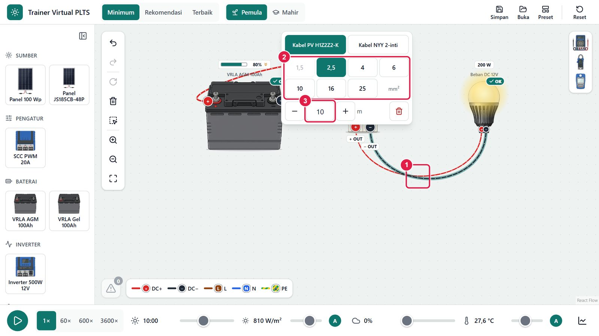
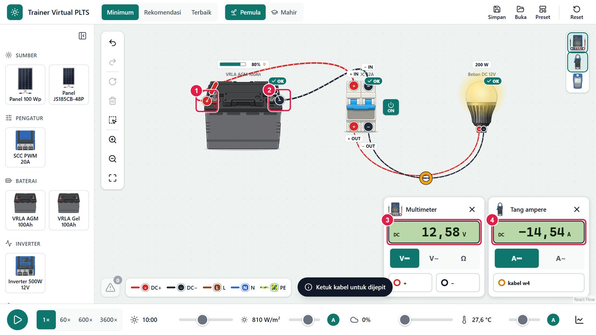
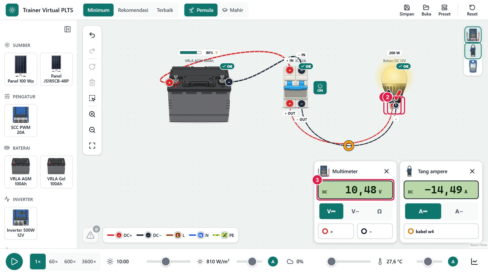

# LKPD 6 — Penampang dan Panjang Kabel terhadap Jatuh Tegangan

Paket: Minimum (off-grid 12 V) · Waktu: 2 × 45 menit · Berkas: lkpd6-jatuh-tegangan.simplts.json

## A. Tujuan

1. Mengubah penampang dan panjang kabel di SimPLTS.
2. Mengukur jatuh tegangan antara baterai dan beban DC.
3. Menghitung resistansi kabel R = ρ · 2L / A dan membandingkannya dengan hasil ukur.

## B. Alat dan Bahan

- SimPLTS dan berkas lkpd6-jatuh-tegangan.simplts.json
- Multimeter dan tang ampere (di SimPLTS)
- Kalkulator

## C. Dasar Teori Singkat

Resistansi satu penghantar R = ρ · L / A, dengan ρ tembaga = 0,0175 Ω·mm²/m. Arus lewat kabel pergi dan pulang, jadi resistansi lintasan = ρ · 2L / A (L = panjang satu penghantar).

Jatuh tegangan ΔV = I × R lintasan. Pada sistem 12 V, jatuh tegangan 1 V sudah sekitar 8% dari tegangan sistem.

Rangkaian latihan: baterai 12 V → MCB DC 32A → beban DC 200 W. Kabel MCB–beban panjang 10 m, penampang 2,5 mm².

## D. Keselamatan Kerja

- Ubah kabel saat MCB OFF.
- Penampang kabel juga harus memenuhi kuat hantar arus (KHA), bukan hanya jatuh tegangan.

## E. Langkah Kerja

1. Buka berkas lkpd6-jatuh-tegangan.simplts.json. Ketuk kabel merah dari MCB ke beban (1). Panel kabel muncul di atas meja: (2) pilihan penampang dan (3) panjang kabel. Catat nilai awalnya. Ketuk area kosong untuk menutup.

   

   *Gambar 6.1. Mengubah penampang dan panjang kabel*

2. Nyalakan MCB. Ukur tegangan di terminal baterai (1)(2): baca (3). Jepit kabel + dengan tang ampere: baca arus (4). Catat di Tabel 1.

   

   *Gambar 6.2. Tegangan baterai dan arus beban*

3. Pindahkan probe ke terminal + (1) dan − (2) beban DC. Baca tegangan beban (3). Hitung jatuh tegangan ΔV = V baterai − V beban.

   

   *Gambar 6.3. Tegangan di terminal beban*

4. Matikan MCB. Ubah penampang KEDUA kabel MCB–beban (merah dan hitam) menjadi 4, 6, lalu 10 mm² dengan panjang tetap 10 m. Setiap kali, nyalakan MCB dan ulangi langkah 2–3. Isi Tabel 1.

5. Kembalikan penampang ke 2,5 mm². Ubah panjang KEDUA kabel menjadi 2, 5, lalu 20 m (tombol − / + atau ketik angka). Ulangi pengukuran dan isi Tabel 2.

6. Hitung R lintasan = 0,0175 × 2L ÷ A untuk setiap baris, lalu ΔV hitung = I × R. Bandingkan dengan ΔV ukur.

## F. Data Pengamatan

**Tabel 1. Pengaruh penampang (panjang 10 m)**

| A (mm²) | V baterai (V) | V beban (V) | I (A) | ΔV ukur (V) | R hitung (Ω) | ΔV hitung (V) |
| --- | --- | --- | --- | --- | --- | --- |
| 2,5 |   |   |   |   |   |   |
| 4 |   |   |   |   |   |   |
| 6 |   |   |   |   |   |   |
| 10 |   |   |   |   |   |   |

**Tabel 2. Pengaruh panjang (penampang 2,5 mm²)**

| L (m) | V baterai (V) | V beban (V) | I (A) | ΔV ukur (V) | R hitung (Ω) | ΔV hitung (V) |
| --- | --- | --- | --- | --- | --- | --- |
| 2 |   |   |   |   |   |   |
| 5 |   |   |   |   |   |   |
| 10 |   |   |   |   |   |   |
| 20 |   |   |   |   |   |   |

## G. Grafik

Buat grafik ΔV terhadap panjang kabel (Tabel 2) dan ΔV terhadap penampang (Tabel 1).

## H. Pertanyaan Analisis

1. Bagaimana hubungan jatuh tegangan dengan panjang kabel? Dengan penampang kabel?
2. Mengapa daya lampu berkurang saat kabel panjang dan kecil? (Petunjuk: P = V² / R beban.)
3. ΔV hitung biasanya sedikit lebih kecil daripada ΔV ukur. Sebutkan penyebab yang mungkin.
4. Bila batas jatuh tegangan 3% dari 12 V, berapa penampang minimum untuk kabel 10 m pada arus 15 A?
5. Mengapa sistem PLTS dengan kabel panjang lebih baik memakai tegangan sistem 24 V atau 48 V?

## I. Kesimpulan

…
