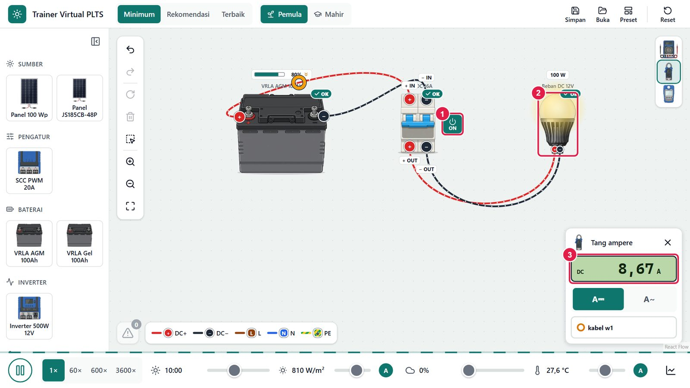
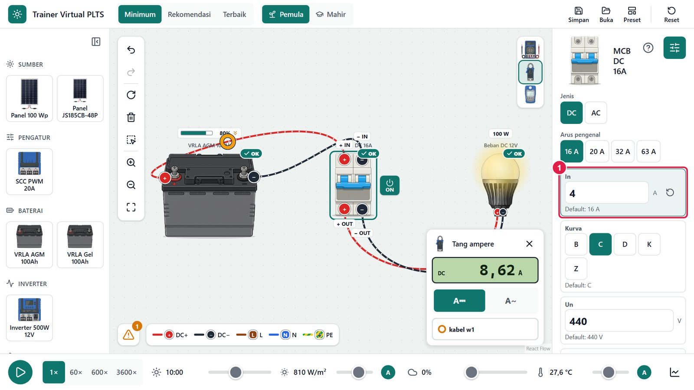
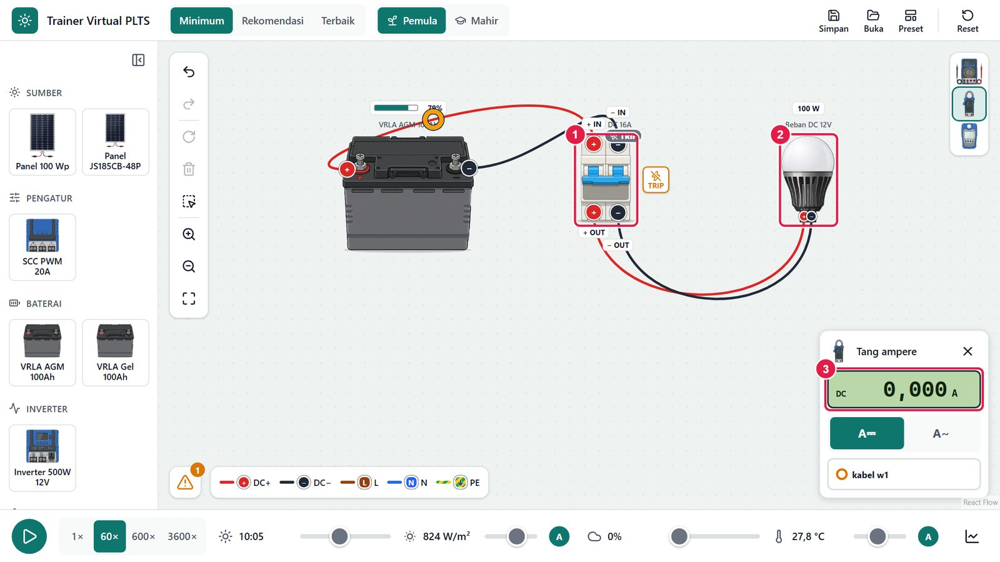
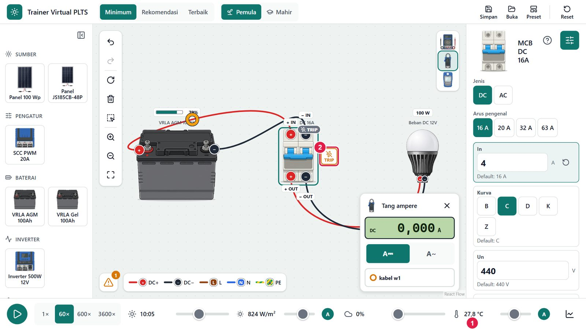
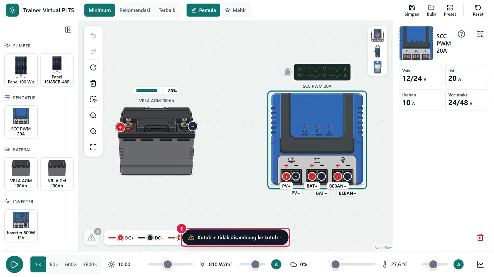
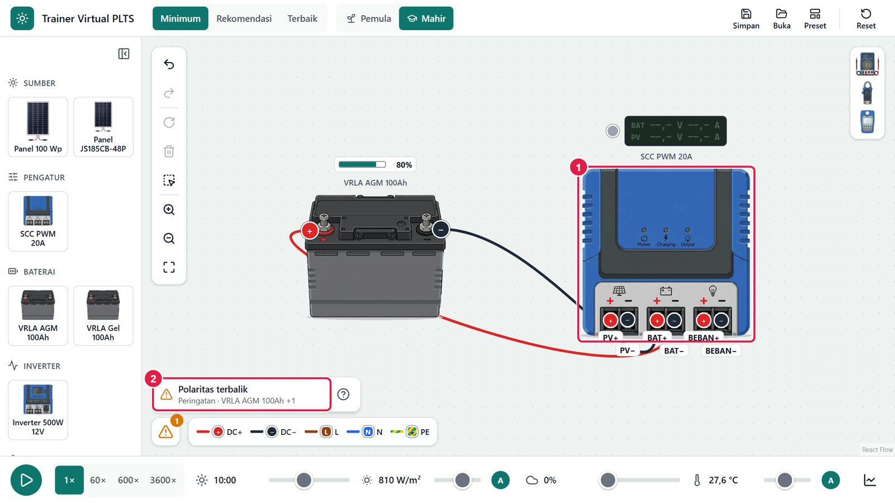
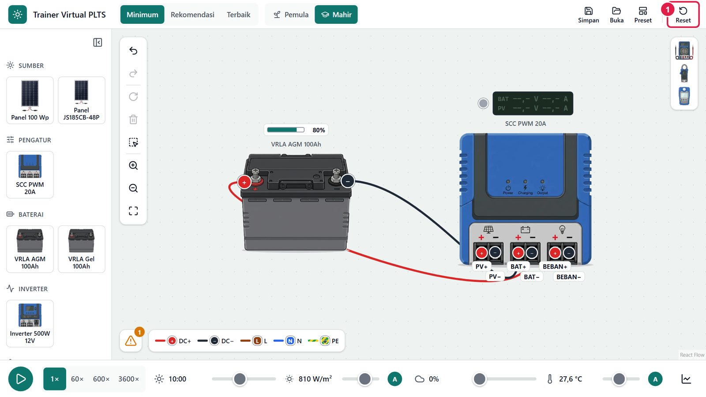
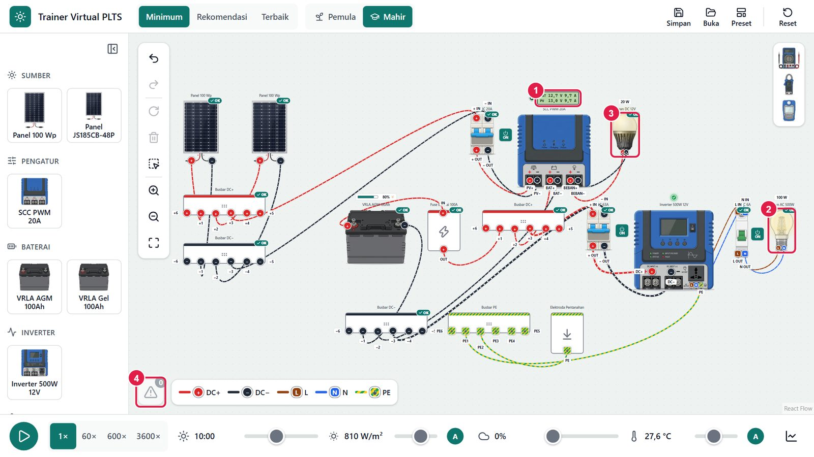

# LKPD 7 — Proteksi dan Pencarian Gangguan PLTS Off-Grid

Paket: Minimum (off-grid 12 V) · Waktu: 3 × 45 menit · Berkas: lkpd7-proteksi.simplts.json, lkpd7-sistem-normal.simplts.json, lkpd7-gangguan-A/B/C.simplts.json

## A. Tujuan

1. Mengamati kerja MCB saat arus melebihi arus pengenal, lalu memulihkannya.
2. Membedakan akibat polaritas terbalik pada tingkat Pemula dan Mahir.
3. Mencari penyebab gangguan berdasarkan bukti pengukuran dan menuliskan perbaikannya.

## B. Alat dan Bahan

- SimPLTS dan lima berkas rangkaian dari instruktur
- Multimeter dan tang ampere (di SimPLTS)

## C. Dasar Teori Singkat

MCB trip bila arus melebihi arus pengenal (In). Makin besar kelebihannya, makin cepat trip (kurva arus–waktu). Setelah trip, cari penyebab dahulu sebelum MCB dinyalakan lagi.

Polaritas terbalik dapat merusak alat tanpa proteksi. Akibatnya ditentukan oleh model alat: ada yang hanya tidak menyala, ada yang rusak.

Pencarian gangguan: amati gejala → bandingkan dengan sistem normal → ukur di titik-titik yang dicurigai → tentukan penyebab dengan bukti → perbaiki → uji ulang.

## D. Keselamatan Kerja

- Jangan menyalakan ulang MCB yang trip sebelum penyebabnya ditemukan.
- Pada bagian C, jangan membuka segitiga temuan sebelum menulis dugaan dan bukti ukur sendiri.

## E. Langkah Kerja

### A. MCB trip karena beban lebih

1. Buka berkas lkpd7-proteksi.simplts.json (baterai → MCB DC 16A → beban DC 100 W). Nyalakan MCB (1) dan jalankan simulasi. Lampu menyala (2). Jepit kabel + baterai dengan tang ampere (3) dan catat arusnya di Tabel 1.

   

   *Gambar 7.1. Rangkaian proteksi dalam keadaan normal*

2. Jeda simulasi. Ketuk MCB, ketuk ikon "Atur parameter" di inspektur, lalu ubah In (1) menjadi 4 A dan tekan Enter. Ketuk "Selesai mengatur". (Langkah ini meniru MCB yang ratingnya terlalu kecil.)

   

   *Gambar 7.2. Mengubah arus pengenal MCB*

3. Pilih kecepatan 60× dan jalankan simulasi. Amati MCB (1), beban (2), dan tang ampere (3) sampai MCB trip. Catat jam simulasi saat trip di Tabel 1.

   

   *Gambar 7.3. MCB trip, arus terputus*

4. Pulihkan: jeda simulasi, buka "Atur parameter" pada MCB, ketuk "Kembalikan semua ke default" (1), lalu nyalakan tuas MCB (2). Pastikan beban menyala lagi.

   

   *Gambar 7.4. Mengembalikan In dan menyalakan MCB*

### B. Polaritas terbalik

5. Taruh baterai dan SCC dari baki ke meja (tingkat Pemula). Coba sambung + baterai ke BAT− SCC. Baca pesan penolakan (1).

   

   *Gambar 7.5. Tingkat Pemula menolak polaritas terbalik*

6. Pilih tingkat Mahir. Sambung + baterai ke BAT− SCC dan − baterai ke BAT+ SCC. Jalankan simulasi. Amati SCC (1) dan buka segitiga temuan (2). Catat di Tabel 2.

   

   *Gambar 7.6. Akibat polaritas terbalik pada SCC*

7. Ketuk Reset (1) di bilah atas dua kali untuk mereset percobaan. Perbaiki kabel dengan polaritas yang benar.

   

   *Gambar 7.7. Reset percobaan*

### C. Mencari gangguan

8. Buka lkpd7-sistem-normal.simplts.json dan jalankan simulasi (1×). Ini acuan sistem yang sehat. Catat bacaan LCD SCC (1), keadaan beban AC (2) dan beban DC (3), serta jumlah temuan (4) di Tabel 3.

   

   *Gambar 7.8. Sistem normal sebagai acuan*

9. Buka lkpd7-gangguan-A.simplts.json. Jalankan simulasi pada 60× selama ±30 detik. Catat gejala, lakukan pengukuran (tegangan di terminal, arus pada kabel), tulis dugaan penyebab dan buktinya di Tabel 3. Setelah itu buka segitiga temuan; bila ada temuan, bandingkan dengan dugaanmu. Tidak semua gangguan memunculkan temuan, jadi bukti ukur tetap yang utama.

10. Ulangi langkah 9 untuk lkpd7-gangguan-B.simplts.json dan lkpd7-gangguan-C.simplts.json. Petunjuk: bandingkan tegangan di terminal BAT SCC dengan tegangan di terminal baterai, dan arus tiap panel dengan arus pada sistem normal.

11. Perbaiki tiap gangguan di SimPLTS (ganti varian MCB, ubah kabel, atau pasang kabel yang hilang). Jalankan lagi dan pastikan gejalanya hilang.

## F. Data Pengamatan

**Tabel 1. MCB trip**

| Keadaan | In MCB (A) | Arus beban (A) | Arus ÷ In | Hasil / jam trip |
| --- | --- | --- | --- | --- |
| Normal | 16 |   |   |   |
| In diubah | 4 |   |   |   |
| Setelah dipulihkan | 16 |   |   |   |

**Tabel 2. Polaritas terbalik**

| Tingkat | Yang terjadi | Pesan / temuan |
| --- | --- | --- |
| Pemula |   |   |
| Mahir |   |   |

**Tabel 3. Pencarian gangguan**

| Berkas | Gejala | Titik ukur dan hasil | Dugaan penyebab | Perbaikan |
| --- | --- | --- | --- | --- |
| Normal |  |  | (tidak ada) | — |
| Gangguan A |   |   |   |   |
| Gangguan B |   |   |   |   |
| Gangguan C |   |   |   |   |

## G. Pertanyaan Analisis

1. Mengapa MCB tidak langsung trip saat arus sedikit di atas In, tetapi trip lebih cepat saat arus jauh di atas In?
2. Apa bahaya menaikkan rating MCB atau fuse begitu saja agar tidak trip lagi?
3. Mengapa tingkat Pemula menolak polaritas terbalik, sedangkan tingkat Mahir membiarkannya?
4. Pada gangguan B, mengapa SCC "mengira" baterai sudah penuh?
5. Susun langkah umum mencari gangguan pada PLTS off-grid berdasarkan pengalaman bagian C.

## H. Kesimpulan

…
